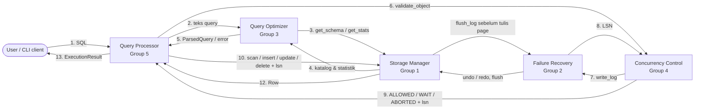
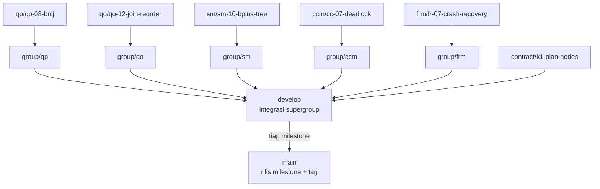

# CoachDB

**CoachDB** adalah *mini Database Management System* (mDBMS) relasional yang dikembangkan oleh supergroup CoachDB untuk Tugas Besar **IF3140 Sistem Basis Data 2026**, Program Studi Teknik Informatika, Institut Teknologi Bandung.

CoachDB menerima query SQL dari banyak client sekaligus, menyusun rencana eksekusi yang optimal, menjaga transaksi yang berjalan bersamaan tetap konsisten, menyimpan data secara permanen di disk, dan memulihkan diri setelah crash.

> **Bahasa:** Python 3.10 atau lebih baru (tim memakai 3.12), hanya library standar.
> **Aturan penting:** anggota sebuah group tidak boleh mengubah kode milik group lain (Spesifikasi 2.2.b), hanya library standar (2.2.d), dan implementasi wajib mengikuti Spesifikasi Komponen (2.2.e). Demo menguji pemahaman individu, jadi setiap PIC harus bisa menjelaskan kodenya sendiri.

**Status:** Milestone 1. Kontrak antarmuka (`common/`) dan mock kelima komponen (`mocks/`) sudah tersedia. Implementasi asli dikerjakan masing-masing group di folder komponennya.

---

## Daftar Isi

1. [Gambaran Sistem](#1-gambaran-sistem)
2. [Anggota Supergroup](#2-anggota-supergroup)
3. [Arsitektur dan Alur Eksekusi](#3-arsitektur-dan-alur-eksekusi)
4. [Komponen](#4-komponen)
5. [Kontrak Antarmuka](#5-kontrak-antarmuka)
6. [Struktur Repository](#6-struktur-repository)
7. [Instalasi dan Menjalankan](#7-instalasi-dan-menjalankan)
8. [SQL yang Didukung](#8-sql-yang-didukung)
9. [Database Contoh](#9-database-contoh)
10. [Git Workflow dan Penamaan Branch](#10-git-workflow-dan-penamaan-branch)
11. [Konvensi Kode](#11-konvensi-kode)
12. [Pengujian](#12-pengujian)
13. [Timeline dan Milestone](#13-timeline-dan-milestone)
14. [Koordinasi Supergroup](#14-koordinasi-supergroup)
15. [Deliverables dan Laporan](#15-deliverables-dan-laporan)
16. [Kontak Asisten](#16-kontak-asisten)
17. [FAQ](#17-faq)

---

## 1. Gambaran Sistem

CoachDB terdiri dari lima komponen. Setiap komponen dikerjakan oleh satu group dan diakses komponen lain hanya lewat facade di `common/interfaces/`.

| Komponen | Singkatan | Group | Folder | Facade | Tanggung jawab inti |
| --- | --- | --- | --- | --- | --- |
| Query Processor | QP | Group 5 | `query_processor/` | `QueryProcessor` | CLI multi-client, menerjemahkan plan, mengeksekusi operator, mengelola transaksi |
| Query Optimizer | QO | Group 3 (Odin) | `query_optimizer/` | `QueryOptimizer` | Parsing SQL, validasi terhadap katalog, optimasi heuristik dan berbasis biaya |
| Storage Manager | SM | Group 1 | `storage_manager/` | `StorageManager` | Penyimpanan blok di disk, buffer, index, katalog, statistik, database contoh |
| Concurrency Control Manager | CCM | Group 4 | `concurrency_control/` | `ConcurrencyControlManager` | Siklus hidup transaksi, Strict 2PL, deadlock, timestamp ordering, serializability |
| Failure Recovery Manager | FRM | Group 2 | `failure_recovery/` | `FailureRecoveryManager` | Write-Ahead Log, rollback, checkpoint, crash recovery, pemulihan historis |

Fitur utama sistem:

- Query `SELECT` dengan `WHERE`, `ORDER BY`, cartesian product, `JOIN ... ON`, dan `NATURAL JOIN` untuk dua tabel atau lebih.
- Perubahan data dengan `INSERT`, `UPDATE`, dan `DELETE`.
- Transaksi eksplisit (`BEGIN`, `COMMIT`, `ABORT`) dan auto-commit.
- Index B+Tree (wajib) dan Hash (opsional) lewat `CREATE INDEX`.
- Optimasi query: pushdown seleksi dan proyeksi, cartesian ke join, pengurutan join, index scan, pemilihan plan termurah, `EXPLAIN`.
- Konkurensi: minimal 2 client bersamaan, protokol lock-based dan timestamp-based yang bisa dipilih.
- Ketahanan: WAL, rollback, checkpoint, recovery otomatis setelah crash, pemulihan ke waktu atau transaksi tertentu.

---

## 2. Anggota Supergroup

**Ketua supergroup:** Angelina Andra Alanna (13524079, Group 3)

Role bertanda *(usulan)* menunggu konfirmasi group masing-masing.

### Group 1 - Storage Manager

| NIM | Nama | Role |
| --- | --- | --- |
| 13524040 | Kloce Paul William Saragih | SM1 (usulan) |
| 13524004 | Muhammad Fatih Irkham Mauludi | SM2 (usulan) |
| 13524085 | Ariel Cornelius Sitorus | SM2b (usulan) |
| 13524088 | Syaqina Octavia Rizha | SM3 (usulan) |
| 13524139 | Azri Arzaq Pohan | SM4 (usulan) |
| 13524091 | Vara Azzara Ramli Pulukadang | SM5 (usulan) |

### Group 2 - Failure Recovery Manager

| NIM | Nama | Role |
| --- | --- | --- |
| 13524016 | Wafiq Hibban Robbany | FR4 Checkpoint |
| 13524028 | Muhammad Nur Majiid | FR2 Log |
| 13524058 | Muhammad Naufal Romi Annafi | FR1 Facade |
| 13524055 | Junior Natra Situmorang | FR3 Undo/callback |
| 13524031 | Vincent Rionarlie | FR5 Recovery |

### Group 3 - Query Optimizer (Odin)

| NIM | Nama | Role |
| --- | --- | --- |
| 13524145 | Angelina Andra Alanna | QO1 |
| 13524049 | Arina Azka | QO2 |
| 13524013 | Anindya Naufal Pinasthika | QO3 |
| 13524097 | Muhammad Faiz Alfada Dharma | QO4 |
| 13524079 | Dzakwan Muhammad K. P. P. (ketua group) | QO5 |

### Group 4 - Concurrency Control Manager

| NIM | Nama | Role |
| --- | --- | --- |
| 13524100 | Arghawisesa Dwinanda Arham | CC1 (usulan) |
| 13524121 | Billy Ontoseno Irawan | CC2 (usulan) |
| 13523037 | Buege Mahara Putra | CC3 (usulan) |
| 13524127 | Fazri Arrashyi Putra | CC4 (usulan) |
| 13524112 | Richard Samuel Simanullang | CC5 (usulan) |

### Group 5 - Query Processor

| NIM | Nama | Role |
| --- | --- | --- |
| 13524019 | Kevin Wirya Valerian | QP1 (usulan) |
| 13524043 | Emilio Justin | QP2 (usulan) |
| 13524007 | Muhammad Ashkar | QP3 (usulan) |
| 13524025 | Moh. Hafizh Irham Perdana | QP4 (usulan) |
| 13523151 | Ardell Aghna Mahendra | QP5 (usulan) |

---

## 3. Arsitektur dan Alur Eksekusi

### 3.1 Diagram komponen



Nomor langkah mengikuti Data Flow Diagram di Guidebook.

### 3.2 Alur query biasa

1. User mengetik SQL di CLI. QP membaca input sampai titik koma.
2. QP memanggil `QO.parse_query`, lalu `QO.optimize_query`.
3. QO melakukan tokenisasi dan parsing, meminta skema dan statistik tabel ke SM, memvalidasi, mengoptimasi, dan memilih plan termurah (atau melempar `QuerySyntaxError` / `SemanticError`).
4. Sebelum membaca atau menulis data, QP memanggil `CCM.validate_object` dengan `ResourceId` daun (tabel atau baris) dan `Action`. CCM sendiri yang mengambil intention lock di tabel.
5. Untuk setiap izin WRITE, CCM menulis tepat satu `LogRecord(DATA)` ke FRM dan mengembalikan LSN-nya di `AccessResponse.lsn`.
6. Jika jawaban `WAIT`, QP mengulang permintaan yang sama setiap 50 ms sampai `ALLOWED` atau `ABORTED`.
7. QP mengeksekusi plan dan memanggil SM dengan LSN tersebut. SM memanggil `flush_log(page_lsn)` sebelum menulis page dirty ke disk (aturan WAL).
8. QP mengembalikan `ExecutionResult` ke client. Error `MdbmsError` dikembalikan sebagai `ok=False`, bukan stack trace.

### 3.3 Alur INSERT

`SM.allocate_rid` → `CCM.validate_object(WRITE, DataChange(INSERT, NO_RECORD, values))` → `SM.insert(t, rid, values, lsn)`. Jika izin tidak ALLOWED, QP memanggil `SM.release_rid(rid)`.

### 3.4 Alur ABORT

ABORT bisa dipicu user, deadlock, atau pelanggaran aturan timestamp. Semuanya lewat satu alur: CCM menulis `ABORT_REQUEST`, memanggil `FRM.rollback`, FRM membalik catatan DATA lewat SM (urut LSN terbalik, operasi undo idempoten), lalu CCM menulis `ABORT` + `flush_log` dan baru melepas lock.

### 3.5 Urutan startup (`main.py`)

| Urutan | Langkah | Yang terjadi |
| --- | --- | --- |
| 1 | `sm = StorageManager(...)` | Memuat katalog dan file tabel, buffer kosong |
| 2 | `frm = FailureRecoveryManager(...)` | Membuka log |
| 3 | `ccm = ConcurrencyControlManager(frm)` | CCM siap menulis log lewat FRM |
| 4 | `frm.set_dependencies(sm, ccm)`, `sm.set_log_flusher(frm.flush_log)` | Memutus ketergantungan melingkar SM dan FRM |
| 5 | `frm.recover()` | Crash recovery dari checkpoint terakhir. Jika gagal, sistem berhenti dengan pesan error |
| 6 | `ccm.set_protocol(...)`, `ccm.initialize(last_tx_id)` | Protokol aktif dicetak, tx_id dimulai dari tx_id terbesar di log + 1 |
| 7 | `qo = QueryOptimizer(sm)`, `qp = QueryProcessor(qo, sm, ccm)` | Sistem siap menerima query |

---

## 4. Komponen

Kode fitur mengikuti Spesifikasi Komponen. Fitur bertanda `*` adalah bonus. Kolom Status diisi `[ ]` belum, `[~]` dikerjakan, `[x]` selesai, dan di-update lewat PR fitur itu sendiri. Daftar requirement juga ada di README tiap folder komponen.

### 4.1 Query Processor - Group 5

Folder: `query_processor/` - Mock: `mocks/mock_query_processor.py`

QP adalah orkestrator: melayani client, mengirim query ke QO, menerjemahkan plan jadi operator eksekusi, meminta izin ke CCM, memanggil SM, dan menampilkan hasil. Demo supergroup dilakukan pada demo komponen QP.

| Role | Nama role | Tanggung jawab |
| --- | --- | --- |
| QP1 | Orchestrator & Client/Server | Alur end-to-end, server multi-client, CLI client, kerangka driver |
| QP2 | Plan Translator & Evaluator | Plan dari QO menjadi langkah eksekusi, evaluasi ekspresi |
| QP3 | Row Operators | Menampilkan data, WHERE, DELETE |
| QP4 | Join & Sort Operators | Join (cartesian, ON, NATURAL) dengan block nested loop, ORDER BY |
| QP5 | Write & Transaction Operators | INSERT, UPDATE, BEGIN/COMMIT/ABORT, index |

| Kode | Fitur | PIC | Target | Status |
| --- | --- | --- | --- | --- |
| QP-01 | Client CLI & Query Execution | QP1 | M2 | [ ] |
| QP-02 | Manajemen Sesi dan Konkurensi Multi-Client | QP1 | M3 | [ ] |
| QP-03 | Menerjemahkan Query Plan | QP2 | M2 | [ ] |
| QP-04 | Mengevaluasi Ekspresi | QP2 | M2 | [ ] |
| QP-05 | Menampilkan Data (SELECT & FROM) | QP3 | M2 | [ ] |
| QP-06 | Menyaring Data (WHERE) | QP3 | M2 | [ ] |
| QP-07 | Menghapus Data (DELETE) | QP3 | M2 | [ ] |
| QP-08 | Menggabungkan Tabel (JOIN) | QP4 | M3 | [ ] |
| QP-09 | Mengurutkan Data (ORDER BY) | QP4 | M3 | [ ] |
| QP-10 | Menambah Data (INSERT) | QP5 | M2 | [ ] |
| QP-11 | Mengubah Data (UPDATE) | QP5 | M2 | [ ] |
| QP-12 | Menjalankan Transaksi (BEGIN, COMMIT, ABORT) | QP5 | M3 | [ ] |
| QP-13 | Membuat dan Menggunakan Index (CREATE INDEX) | QP5 | M3 | [ ] |
| QP-14 | Driver Program Komponen | QP1 | M2 awal, M3 lengkap | [ ] |
| QP-15* | Fitur Ekstra DDL (CREATE TABLE & DROP TABLE) | QP5 (bonus) | Final | [ ] |
| QP-16* | Fitur Ekstra Kueri (LIMIT, AS, Subquery) | QP4 (bonus) | Final | [ ] |

Bergantung pada: QO (plan, K1), SM (data, K3), CCM (izin, K4).
Dipakai oleh: user (CLI), seluruh skenario integrasi.

### 4.2 Query Optimizer - Group 3 (Odin)

Folder: `query_optimizer/` - Mock: `mocks/mock_query_optimizer.py`

QO mengubah teks SQL menjadi plan yang tervalidasi dan teroptimasi. Pipeline: lexer → parser → binder (validasi katalog) → rewrite heuristik → enumerasi kandidat plan → hitung biaya → plan termurah. Perintah transaksi dan `CREATE INDEX` langsung dikembalikan setelah parsing. Satuan biaya adalah jumlah transfer blok.

| Role | Nama role | PIC | Tanggung jawab |
| --- | --- | --- | --- |
| QO1 | Lexer, SELECT Parser & Facade | Dzakwan | Lexer, parser SELECT, pipeline parse → bind → optimize, driver, tampilan plan |
| QO2 | Expression & Statement Parser | Arina | Parser ekspresi & kondisi, UPDATE/INSERT/DELETE, CREATE INDEX, transaksi, DDL bonus |
| QO3 | Binder & Cost Model | Anindya | Validasi katalog, estimasi kardinalitas, biaya plan |
| QO4 | Selection & Projection Rewriter | Faiz | Pemecahan dan pushdown seleksi, penyederhanaan dan pushdown proyeksi |
| QO5 | Join & Access Path Optimizer | Andra | Cartesian ke join, urutan join, index scan, pemilihan plan termurah |

| Kode | Fitur | PIC | Target | Status |
| --- | --- | --- | --- | --- |
| QO-01 | Tokenisasi dan Penanganan Kesalahan Sintaks | QO1 | M2 | [ ] |
| QO-02 | Mengenali Query SELECT | QO1 | M2 | [ ] |
| QO-03 | Mengenali Penggabungan Tabel | QO1 | M2 | [ ] |
| QO-04 | Mengenali Ekspresi dan Kondisi | QO2 | M2 | [ ] |
| QO-05 | Mengenali Query Perubahan Data | QO2 | M2 | [ ] |
| QO-06 | Mengenali Perintah Transaksi dan Indeks | QO2 | M2 | [ ] |
| QO-07 | Memvalidasi Query terhadap Katalog | QO3 | M2 | [ ] |
| QO-08 | Mengestimasi Biaya Query Plan | QO3 | M2 dasar, M3 lengkap | [ ] |
| QO-09 | Mengoptimasi Seleksi | QO4 | M2 | [ ] |
| QO-10 | Mengoptimasi Proyeksi | QO4 | M3 | [ ] |
| QO-11 | Mengubah Cartesian Product menjadi Join | QO5 | M2 | [ ] |
| QO-12 | Menukar Urutan dan Pengelompokan Join | QO5 | M2 dan M3 | [ ] |
| QO-13 | Memanfaatkan Index (Index Scan) | QO5 | M3 | [ ] |
| QO-14 | Memilih Query Plan Terbaik | QO5 | M3 | [ ] |
| QO-15 | Menampilkan Query Plan sebelum dan sesudah Optimasi | QO1 | M2 | [ ] |
| QO-16 | Driver Program Komponen | QO1 | M2 awal, M3 lengkap | [ ] |
| QO-17* | Fitur Ekstra Parsing (CREATE/DROP TABLE, LIMIT, AS, Subquery) | QO1 + QO2 (bonus) | Final | [ ] |
| QO-18* | Optimasi dengan Genetic Algorithm | QO5 (bonus) | Final | [ ] |

Bergantung pada: SM (katalog & statistik, K2).
Dipakai oleh: QP (plan, K1).

### 4.3 Storage Manager - Group 1

Folder: `storage_manager/` - Mock: `mocks/mock_storage_manager.py`

SM adalah satu-satunya komponen yang menyentuh disk. SM juga penyedia yang paling banyak dipakai komponen lain, jadi katalog, statistik, dan database contoh diprioritaskan lebih awal.

| Role | Nama role | Tanggung jawab |
| --- | --- | --- |
| SM1 | CRUD Interface | Operasi baca dan manipulasi data, penghubung SM dengan komponen lain |
| SM2 | Block Manager | File per tabel, layout halaman, alokasi halaman, persistensi |
| SM2b | Buffer & WAL Hook | Buffer, page replacement, flush, hook WAL ke FRM (Group 1 beranggotakan 6 orang, role SM2 dipecah dua) |
| SM3 | Serializer | Encoding/decoding tipe data, serialisasi record |
| SM4 | Catalog Manager | Katalog skema, statistik, metadata, data awal |
| SM5 | Index Manager | B+Tree/Hash, pencarian lewat index |

| Kode | Fitur | PIC | Target | Status |
| --- | --- | --- | --- | --- |
| SM-01 | Menyimpan Data Secara Permanen di Disk | SM2 | M2 | [ ] |
| SM-02 | Menyimpan Tipe Data Integer, Float, Char, dan Varchar | SM3 | M2 | [ ] |
| SM-03 | Menyimpan Record dalam Format Internal | SM3 | M2 | [ ] |
| SM-04 | Mengambil Data Tabel | SM1 | M2 | [ ] |
| SM-05 | Menambah Data | SM1 | M2 | [ ] |
| SM-06 | Mengubah Data | SM1 | M2 | [ ] |
| SM-07 | Menghapus Data | SM1 | M2 | [ ] |
| SM-08 | Mengetahui Struktur Tabel | SM4 | M2 | [ ] |
| SM-09 | Mengetahui Statistik Tabel | SM4 | M2 | [ ] |
| SM-10 | Membuat Index (B+Tree/Hash) | SM5 | M3 | [ ] |
| SM-11 | Mencari Data Lewat Index | SM5 | M3 | [ ] |
| SM-12 | Mempercepat Akses Data dengan Buffer | SM2b | M3 | [ ] |
| SM-13 | Menulis Perubahan ke Disk | SM2b | M3 | [ ] |
| SM-14 | Menyediakan Basis Data Contoh | SM4 | M2 | [ ] |
| SM-15 | Driver Program Komponen | SM1 | M2 awal, M3 lengkap | [ ] |

Bergantung pada: FRM (cek log sudah permanen sebelum flush halaman, K6) lewat callback `set_log_flusher`, tanpa import FRM.
Dipakai oleh: QO (K2), QP (K3), FRM (undo/redo dan flush, K6).

### 4.4 Concurrency Control Manager - Group 4

Folder: `concurrency_control/` - Mock: `mocks/mock_concurrency_control.py`

Catatan: spek tidak konsisten soal CC-07 (tabel kebutuhan: CC5, tabel role: CC2). CoachDB memakai **CC5 dengan CC2 sebagai pendamping**.

CCM menjamin isolasi transaksi. QP meminta izin read/write sebelum menyentuh data, CCM menjawab sesuai protokol aktif. CCM juga jembatan ke FRM untuk log dan rollback. Lock memakai multiple granularity (tabel dan baris) dengan Strict 2PL.

| Role | Nama role | Tanggung jawab |
| --- | --- | --- |
| CC1 | Transaction Manager & Facade | Siklus hidup transaksi, pergantian protokol |
| CC2 | Lock-Based Protocol | Strict 2PL, pendamping penanganan deadlock |
| CC3 | FRM Bridge | Meneruskan catatan, pembatalan, dan pemulihan ke FRM |
| CC4 | Timestamp-Based Protocol | Akses data berdasarkan timestamp, verifikasi serializability |
| CC5 | Deadlock & Schedule Tester | Penanganan deadlock, schedule uji, driver |

| Kode | Fitur | PIC | Target | Status |
| --- | --- | --- | --- | --- |
| CC-01 | Memulai dan Menyelesaikan Transaksi | CC1 | M2 | [ ] |
| CC-02 | Mengganti Protokol Concurrency Control | CC1 | M2 | [ ] |
| CC-03 | Meneruskan Catatan Transaksi ke FRM sesuai WAL | CC3 | M2 | [ ] |
| CC-04 | Mengoordinasikan Pembatalan Transaksi | CC3 | M3 | [ ] |
| CC-05 | Inisialisasi CCM setelah Pemulihan Sistem | CC3 | M3 | [ ] |
| CC-06 | Mengatur Akses Data dengan Penguncian | CC2 | M2 | [ ] |
| CC-07 | Menangani Deadlock | CC5 | M3 | [ ] |
| CC-08 | Mengatur Akses Data Berdasarkan Timestamp | CC4 | M3 | [ ] |
| CC-09 | Memverifikasi Serializability Hasil Eksekusi | CC4 | M3 | [ ] |
| CC-10 | Driver Program Komponen | CC5 | M2 awal, M3 lengkap | [ ] |

Bergantung pada: FRM (log & rollback, K5; checkpoint & startup, K7).
Dipakai oleh: QP (izin & transaksi, K4).

### 4.5 Failure Recovery Manager - Group 2

Folder: `failure_recovery/` - Mock: `mocks/mock_failure_recovery.py`

Catatan: spek tidak konsisten soal FR-05 (tabel kebutuhan: FR4, tabel role: FR3). CoachDB memakai **FR4**.

FRM menjamin atomicity dan durability lewat Write-Ahead Log. FRM dipanggil oleh CCM (log dan rollback) dan oleh SM (memastikan log sudah permanen sebelum halaman ditulis). Rollback tidak memakai CLR; operasi undo di SM dibuat idempoten.

| Role | Nama role | Tanggung jawab |
| --- | --- | --- |
| FR1 | Facade | Pengujian pemulihan multi-transaksi, kerangka driver |
| FR2 | Log | Mencatat perubahan dan peristiwa transaksi, menampilkan log |
| FR3 | Undo/Rollback | Membatalkan transaksi beserta perubahannya |
| FR4 | Checkpoint & PITR | Checkpoint berkala dan manual, pemulihan ke waktu/transaksi tertentu |
| FR5 | Recovery | Pemulihan otomatis setelah sistem mati mendadak |

| Kode | Fitur | PIC | Target | Status |
| --- | --- | --- | --- | --- |
| FR-01 | Mencatat Perubahan Data ke Log (WAL) | FR2 | M2 | [ ] |
| FR-02 | Mencatat Peristiwa Transaksi ke Log | FR2 | M2 | [ ] |
| FR-03 | Menampilkan Isi Log | FR2 | M2 | [ ] |
| FR-04 | Membatalkan Transaksi Beserta Perubahannya | FR3 | M2 (mock SM), M3 (SM asli) | [ ] |
| FR-05 | Memulihkan Basis Data ke Waktu atau Transaksi Tertentu | FR4 | M3 | [ ] |
| FR-06 | Membuat Checkpoint | FR4 | M3 | [ ] |
| FR-07 | Memulihkan Basis Data Otomatis setelah Crash | FR5 | M3 | [ ] |
| FR-08 | Menguji Pemulihan dengan Beberapa Transaksi | FR1 | M3 | [ ] |
| FR-09 | Driver Program Komponen | FR1 | M2 awal, M3 lengkap | [ ] |

Bergantung pada: SM (undo/redo dan flush, K6), CCM (menahan transaksi saat checkpoint, K7).
Dipakai oleh: CCM (K5), SM (K6).

---

## 5. Kontrak Antarmuka

Kontrak adalah kesepakatan bentuk data dan method yang dipakai lintas komponen. Sumber kebenarannya adalah kode:

- Shared data type: `common/` (bisa di-import langsung, misalnya `from common import RID, Row, DataChange`).
- Facade: `common/interfaces/` (ABC kelima komponen).
- Keputusan desain: [`docs/decisions.md`](docs/decisions.md).
- Riwayat perubahan: [`docs/changelog-kontrak.md`](docs/changelog-kontrak.md).

Kontrak ini disalin ke bagian Kontrak Antarmuka di Laporan Supergroup.

| Kode | Kontrak | Penyedia → pemakai | Lokasi | Isi |
| --- | --- | --- | --- | --- |
| K0 | Tipe bersama | Semua | `common/catalog.py`, `storage.py`, `transaction.py`, `errors.py` | `DataType`, `RID`, `Row`, `NO_RECORD` (berbeda dari `None`), hierarki `MdbmsError`, tx_id |
| K1 | Query plan & ParsedQuery | QO → QP | `common/plan.py`, `expression.py`, `interfaces/query_optimizer.py` | Node plan, pohon ekspresi, `parse_query`, `optimize_query`, `get_cost`, `explain` |
| K2 | Katalog & statistik | SM → QO | `common/catalog.py`, `interfaces/storage_manager.py` | `list_tables`, `get_schema`, `get_stats` (n_r, b_r, l_r, f_r, V(A,r)), daftar index |
| K3 | Akses data | SM → QP | `interfaces/storage_manager.py` | `scan`, `fetch`, `allocate_rid`/`release_rid`, `insert`, `update`, `delete`, `delete_all`, `create_index`, `index_lookup`, `index_range` |
| K4 | Izin akses & transaksi | CCM → QP | `common/transaction.py`, `interfaces/concurrency_control.py` | `begin_transaction`, `validate_object` → ALLOWED/WAIT/ABORTED + lsn, `commit`, `abort`, retry WAIT |
| K5 | Logging & rollback | FRM → CCM | `common/log.py`, `interfaces/failure_recovery.py` | `write_log` (BEGIN/DATA/COMMIT/ABORT_REQUEST/ABORT) → LSN, `rollback`, `read_log` |
| K6 | WAL & flush | SM ↔ FRM | `set_log_flusher`, `flush_log`, `SM.flush` | SM memanggil `flush_log(page_lsn)` sebelum menulis page, undo/redo lewat SM dengan `lsn=None` |
| K7 | Checkpoint & startup | FRM ↔ CCM | `checkpoint`, `recover`, `initialize`, `pause_new_transactions`, `wait_until_idle`, `resume_transactions` | CCM menahan transaksi baru saat checkpoint; urutan startup di `main.py` |

### Node plan (K1)

Semua node turunan `PlanNode` (`children`, `output_columns`, `estimated_rows`, `estimated_cost`) dan dibuat dengan keyword argument.

| Node | Field |
| --- | --- |
| `TableScan` | `table` |
| `IndexScan` | `table`, `index: IndexInfo`, `op: CompOp`, `key` (kesamaan) atau `low`/`high` (rentang) |
| `Filter` | `condition: Expression` |
| `Project` | `columns: list[ColumnRef]` |
| `Join` | `kind: JoinKind` (CROSS, THETA, NATURAL), `condition`, `algorithm = "BNLJ"` |
| `Sort` | `column: ColumnRef`, `ascending` |
| `Insert` | `table`, `values: list[Literal]` |
| `Update` | `table`, `column`, `expression` |
| `Delete` | `table` |
| `CreateIndex` | `index: IndexInfo` |

Perintah transaksi tidak punya node plan: `ParsedQuery(kind=TRANSACTION, command=BEGIN|COMMIT|ABORT)`.

### Keputusan lintas komponen

Ringkasan dari [`docs/decisions.md`](docs/decisions.md):

| Keputusan | Hasil |
| --- | --- |
| Bahasa pemrograman | Python 3.10+ (tim memakai 3.12), library standar saja |
| Granularity lock | Multiple granularity tabel dan baris (`IS`, `IX`, `S`, `SIX`, `X`), Strict 2PL |
| Perilaku WAIT | Non-blocking, QP mengulang permintaan tiap 50 ms |
| Jenis index dan sintaks | B+Tree wajib, Hash opsional, `CREATE INDEX n ON t(k) [USING BTREE\|HASH]` |
| Algoritma join di QP | Block Nested Loop Join, biaya dalam transfer blok |
| Protokol CCM default | `LOCK_BASED`, ganti dengan `--protocol timestamp` |
| Jalur log | CCM menulis log DATA untuk tiap izin WRITE, LSN diteruskan QP ke SM |
| Rollback | Satu alur ABORT, tanpa CLR, undo SM idempoten |
| RID | `(table, page_id, slot)` |
| Client-server | TCP, JSON per baris, port 5440 |
| Bonus QP-15/16 dan QO-17 | Diputuskan Kamis, 5 November 2026 |

### Aturan perubahan kontrak

- Kontrak dibekukan (**freeze**) pada **Selasa, 27 Oktober 2026 pukul 21.00**.
- Setelah freeze, perubahan hanya lewat branch `contract/*` dan PR berlabel `kontrak`.
- PR kontrak wajib disetujui minimal satu orang dari **setiap** group yang terdampak.
- Setiap perubahan dicatat di [`docs/changelog-kontrak.md`](docs/changelog-kontrak.md) beserta tanggal dan alasan, dan `tests/test_contract.py` harus tetap lulus.
- Perubahan diumumkan di grup supergroup pada hari yang sama.

---

## 6. Struktur Repository

```
mdbms-coachdb/
├── README.md                  # dokumen ini
├── main.py                    # bootstrap: SM → FRM → CCM → recover → QO → QP
├── .gitignore
├── .github/
│   └── CODEOWNERS             # pemilik tiap folder
├── docs/
│   ├── decisions.md           # keputusan desain lintas komponen
│   └── changelog-kontrak.md   # riwayat perubahan kontrak
├── common/                    # K0-K7: tipe bersama, dimiliki semua group
│   ├── config.py              # BLOCK_SIZE, BUFFER_FRAMES, DATA_DIR, HOST, PORT, DEFAULT_PROTOCOL
│   ├── catalog.py             # DataType, ColumnSchema, ForeignKey, TableSchema, IndexKind, IndexInfo, TableStats
│   ├── storage.py             # RID, Row
│   ├── expression.py          # Expression, ColumnRef, Literal, ArithOp, BinaryOp, CompOp, Comparison, And
│   ├── plan.py                # QueryKind, TransactionCommand, ParsedQuery, PlanNode dan turunannya, JoinKind
│   ├── transaction.py         # Action, ResourceId, ChangeOp, DataChange, NO_RECORD, AccessResponse, TxResult, ...
│   ├── log.py                 # LogKind, LogRecord, LogResult, CheckpointResult, RecoveryTarget, RecoveryResult
│   ├── result.py              # ExecutionResult
│   ├── errors.py              # MdbmsError dan turunannya
│   └── interfaces/            # ABC facade kelima komponen
├── mocks/                     # mock kelima facade (Milestone 1)
├── query_processor/           # Group 5
├── query_optimizer/           # Group 3
├── storage_manager/           # Group 1
├── concurrency_control/       # Group 4
├── failure_recovery/          # Group 2
└── tests/
    └── test_contract.py       # uji kontrak dan smoke test dengan mock
```

Isi folder di dalam tiap komponen diatur oleh group masing-masing. Driver komponen, server, CLI client, dan database contoh asli ditambahkan oleh group pemiliknya. `data/` dibuat saat runtime dan diabaikan git.

### Kepemilikan folder

| Folder / file | Pemilik | Siapa yang approve PR |
| --- | --- | --- |
| `query_processor/`, `mocks/mock_query_processor.py`, `main.py` | Group 5 | Anggota Group 5 |
| `query_optimizer/`, `mocks/mock_query_optimizer.py` | Group 3 | Anggota Group 3 |
| `storage_manager/`, `mocks/mock_storage_manager.py`, `common/config.py` | Group 1 | Anggota Group 1 |
| `concurrency_control/`, `mocks/mock_concurrency_control.py` | Group 4 | Anggota Group 4 |
| `failure_recovery/`, `mocks/mock_failure_recovery.py` | Group 2 | Anggota Group 2 |
| `common/`, `tests/test_contract.py`, `docs/changelog-kontrak.md` | Semua group | Satu orang dari setiap group terdampak |
| `README.md`, `docs/decisions.md`, `.github/` | Ketua supergroup | Ketua supergroup |

Komponen lain hanya boleh di-import lewat `common.interfaces`, tidak boleh import kelas internal komponen lain.

---

## 7. Instalasi dan Menjalankan

### Prasyarat

- Python **3.10** atau lebih baru (cek dengan `python --version`)
- Git
- Tidak ada dependency eksternal. Jangan menambahkan `requirements.txt` berisi library pihak ketiga.

### Clone

```bash
git clone https://github.com/Tubes-Sistem-Basis-Data/mdbms-coachdb.git
cd mdbms-coachdb
```

### Menjalankan

```bash
# bootstrap dengan mock semua komponen (default)
python main.py --mock

# jalankan query contoh lewat qp.execute_query dan cetak hasilnya
python main.py --mock --demo

# memilih protokol concurrency control
python main.py --mock --protocol lock
python main.py --mock --protocol timestamp

# direktori data
python main.py --mock --data-dir data
```

Saat start, sistem mencetak protokol yang aktif. Jika recovery gagal, program keluar dengan kode 1 dan pesan error. `--no-mock` akan dipakai setelah komponen asli tersedia.

Contoh keluaran `--demo` (dipotong):

```
Protokol aktif: LOCK_BASED

> SELECT * FROM student;
id | name  | gpa  | gender
---+-------+------+-------
1  | Andi  | 3.75 | L
...
5 baris

> BEGIN;
BEGIN (tx 2)
...
> ABORT;
ABORT (tx 2)
```

### Rencana sesi client

Server socket dan CLI client dibuat Group 5 (QP-01, QP-02). Sintaks yang direncanakan:

```
coachdb> SELECT name, gpa FROM student WHERE gpa > 3.5 ORDER BY gpa DESC;
coachdb> BEGIN;
coachdb> UPDATE student SET gpa = gpa + 0.1 WHERE id = 3;
coachdb> COMMIT;
coachdb> EXPLAIN SELECT s.name FROM student s, enrollment e WHERE s.id = e.student_id;
coachdb> exit
```

---

## 8. SQL yang Didukung

| Kategori | Sintaks | Komponen utama |
| --- | --- | --- |
| Seleksi | `SELECT * \| a, b FROM t [WHERE kondisi] [ORDER BY kol [ASC\|DESC]];` | QO-02, QP-05, QP-06, QP-09 |
| Join | `FROM t1, t2` - `t1 JOIN t2 ON kondisi` - `t1 NATURAL JOIN t2` | QO-03, QP-08 |
| Ekspresi | `= <> > >= < <=`, `+ - * /`, `AND`, kurung, kolom vs nilai, kolom vs kolom | QO-04, QP-04 |
| Insert | `INSERT INTO t VALUES (v1, v2, ...);` | QO-05, QP-10 |
| Update | `UPDATE t SET kol = ekspresi [WHERE kondisi];` (satu kolom) | QO-05, QP-11 |
| Delete | `DELETE FROM t [WHERE kondisi];` | QO-05, QP-07 |
| Transaksi | `BEGIN [TRANSACTION];` - `COMMIT;` - `ABORT;` | QO-06, QP-12 |
| Index | `CREATE INDEX nama ON t(kol) [USING BTREE\|HASH];` (default BTREE) | QO-06, QP-13 |
| Explain | `EXPLAIN <query>;` | QO-15 |
| Bonus | `CREATE TABLE`, `DROP TABLE ... CASCADE\|RESTRICT`, `LIMIT n`, `AS`, subquery di `WHERE` | QO-17, QP-15, QP-16 |

Tipe data: `INTEGER`, `FLOAT`, `CHAR(n)`, `VARCHAR(n)`. Keyword tidak case-sensitive. Query boleh ditulis multi-baris dan diakhiri titik koma.

Mock QO saat ini hanya mengenali `BEGIN [TRANSACTION]`, `COMMIT`, `ABORT`, `SELECT * FROM <t>`, dan `EXPLAIN SELECT * FROM <t>`. Bentuk lain dijawab `mock: belum didukung`.

---

## 9. Database Contoh

Database contoh asli disediakan Group 1 (SM-14). Mock SM sudah memuat skema yang sama dengan 5 baris per tabel:

| Tabel | Kolom | Baris (mock / asli) |
| --- | --- | --- |
| `student` | `id INTEGER` (PK), `name VARCHAR(50)`, `gpa FLOAT`, `gender CHAR(1)` | 5 / min. 50 |
| `course` | `id INTEGER` (PK), `title VARCHAR(50)`, `credits INTEGER`, `dept CHAR(3)` | 5 / min. 50 |
| `enrollment` | `student_id INTEGER` (FK student.id), `course_id INTEGER` (FK course.id), `grade CHAR(2)`, `score FLOAT` | 5 / min. 50 |

Syarat spek: minimal 3 tabel berelasi, minimal 50 baris per tabel, mencakup keempat tipe data, dan dapat dimuat saat sistem dijalankan.

---

## 10. Git Workflow dan Penamaan Branch

### 10.1 Struktur branch



Arah panah adalah arah Pull Request (dari mana ke mana kode digabung).

### 10.2 Jenis branch

| Branch | Contoh | Fungsi | Dibuat dari | PR ke | Siapa yang merge |
| --- | --- | --- | --- | --- | --- |
| `main` | `main` | Versi yang dirilis untuk milestone, yang dinilai asisten | - | - | PIC integrasi |
| `develop` | `develop` | Tempat kelima komponen bertemu, harus selalu bisa dijalankan | `main` | `main` | PIC integrasi |
| `group/<komponen>` | `group/qo` | Integrasi internal satu group sebelum masuk `develop` | `develop` | `develop` | Ketua/facade group |
| `<komponen>/<kode-fitur>-<deskripsi>` | `qo/qo-12-join-reorder` | Mengerjakan satu fitur dari spek | `group/<komponen>` | `group/<komponen>` | Penulis, setelah di-approve |
| `<komponen>/fix-<deskripsi>` | `sm/fix-buffer-eviction-dirty-page` | Memperbaiki bug | `group/<komponen>` | `group/<komponen>` | Penulis, setelah di-approve |
| `<komponen>/test-<deskripsi>` | `ccm/test-three-way-deadlock` | Menambah skenario uji atau driver | `group/<komponen>` | `group/<komponen>` | Penulis, setelah di-approve |
| `<komponen>/mock-<deskripsi>` | `frm/mock-log-api` | Memperbarui mock | `group/<komponen>` | `group/<komponen>` | Penulis, setelah di-approve |
| `<komponen>/refactor-<deskripsi>` | `qp/refactor-operator-iterator` | Merapikan kode tanpa mengubah perilaku | `group/<komponen>` | `group/<komponen>` | Penulis, setelah di-approve |
| `contract/<kode-kontrak>-<deskripsi>` | `contract/k4-wait-response` | Mengubah `common/` atau kontrak | `develop` | `develop` | PIC integrasi, setelah semua group terdampak approve |
| `integration/<deskripsi>` | `integration/qp-ccm-two-clients` | Skenario uji lintas komponen | `develop` | `develop` | PIC integrasi |
| `docs/<deskripsi>` | `docs/milestone-2-notes` | Dokumentasi umum (README, keputusan) | `develop` | `develop` | Ketua supergroup |
| `hotfix/<deskripsi>` | `hotfix/release-crash-on-start` | Perbaikan darurat setelah rilis | `main` | `main` dan `develop` | PIC integrasi |

### 10.3 Kode komponen di nama branch

| Komponen | Prefix branch | Branch group | Kode fitur | Contoh branch fitur |
| --- | --- | --- | --- | --- |
| Query Processor | `qp/` | `group/qp` | `qp-01` s.d. `qp-16` | `qp/qp-02-multi-client-server` |
| Query Optimizer | `qo/` | `group/qo` | `qo-01` s.d. `qo-18` | `qo/qo-04-expression-parser` |
| Storage Manager | `sm/` | `group/sm` | `sm-01` s.d. `sm-15` | `sm/sm-12-buffer-pool` |
| Concurrency Control | `ccm/` | `group/ccm` | `cc-01` s.d. `cc-10` | `ccm/cc-06-strict-2pl` |
| Failure Recovery | `frm/` | `group/frm` | `fr-01` s.d. `fr-09` | `frm/fr-01-wal-writer` |

Prefix branch CCM adalah `ccm/`, tetapi kode fiturnya tetap `cc-xx` sesuai spek. FRM prefixnya `frm/`, kode fiturnya `fr-xx`.

### 10.4 Aturan penamaan

1. **Huruf kecil semua.** `qo/qo-12-join-reorder`, bukan `QO/QO-12-JoinReorder`.
2. **Pisahkan kata dengan tanda hubung** (`-`). Jangan pakai spasi, underscore, atau camelCase.
3. **Awali dengan kode fitur spek** kalau branch mengerjakan fitur tertentu.
4. **Deskripsi singkat, 2 sampai 5 kata**, bahasa Inggris atau Indonesia (konsisten per group).
5. **Jangan pakai nama orang atau nama kelompok.** Penulis sudah tercatat di commit.
6. **Satu branch untuk satu fitur.** Fitur besar dipecah per tahap: `qo/qo-12-swap-sides`, lalu `qo/qo-12-associative`.
7. **Hapus branch setelah PR di-merge.**

| Salah | Kenapa | Benar |
| --- | --- | --- |
| `feat/query-optimizer-odin` | Nama kelompok, bukan pola supergroup | `group/qo` |
| `qo2-parsing-arina` | Nama orang, tanpa kode fitur | `qo/qo-04-expression-parser` |
| `SM_BPlusTree` | Huruf besar, underscore, tanpa kode fitur | `sm/sm-10-bplus-tree` |
| `fix` | Tidak jelas komponen dan masalahnya | `ccm/fix-lock-upgrade-deadlock` |
| `qp/qp-08-join-and-sort-and-index` | Lebih dari satu fitur | `qp/qp-08-bnlj` dan `qp/qp-09-order-by` |

### 10.5 Format commit

```
[<KODE>] <ringkasan singkat dalam satu kalimat>

<penjelasan opsional: apa yang berubah dan kenapa>
```

- `<KODE>` adalah kode fitur (`QO-12`, `SM-10`, `CC-07`), nama komponen (`QP`, `QO`, `SM`, `CCM`, `FRM`) untuk perubahan umum, `K0` sampai `K7` untuk kontrak, atau `DOCS` dan `INT` untuk dokumentasi dan integrasi.
- Ringkasan maksimal sekitar 72 karakter.
- Semua commit atas nama anggota yang mengerjakan.

```
[QO-12] tambah pertukaran sisi join berdasarkan biaya
[SM-12] ganti page replacement dari FIFO ke LRU
[CC-07] deteksi siklus wait-for graph tiap transaksi menunggu
[FR-07] abaikan entri log terakhir yang terpotong saat recovery
[K4] tambah status WAIT pada respons request
[INT] skenario dua client menulis baris yang sama
[DOCS] isi tabel keputusan kickoff
```

### 10.6 Alur kerja harian

```bash
# 1. ambil versi terbaru branch group
git checkout group/qo
git pull origin group/qo

# 2. buat branch fitur
git checkout -b qo/qo-12-join-reorder

# 3. kerjakan, commit kecil-kecil
git add query_optimizer/
git commit -m "[QO-12] tambah pertukaran sisi join berdasarkan biaya"

# 4. sebelum push, sinkronkan dengan branch group
git fetch origin
git rebase origin/group/qo        # atau: git merge origin/group/qo

# 5. push dan buka PR ke group/qo
git push -u origin qo/qo-12-join-reorder
```

Facade/ketua group, minimal sekali sehari:

```bash
git checkout group/qo
git pull origin group/qo
git merge origin/develop          # tarik perubahan group lain
git push origin group/qo
```

Menjelang sync Senin dan Kamis, facade membuka PR `group/<komponen>` → `develop`.

### 10.7 Pull Request

Setiap PR wajib:

- Judul mengikuti format commit, contoh `[QO-12] Pertukaran urutan join`.
- Deskripsi memakai format berikut:

```markdown
## Fitur
Kode: QO-12 - PIC: QO5

## Perubahan
- ...

## Acceptance criteria yang dipenuhi
- [ ] ...

## Cara menguji
python -m unittest discover -s tests -v

## Dampak ke komponen lain
Tidak ada / kontrak K1 berubah (lihat PR contract/...)
```

- Lulus `python -m unittest discover -s tests`.
- Mendapat minimal **1 approval** dari pemilik folder (CODEOWNERS). PR `contract/*` butuh approval dari setiap group terdampak.
- Tidak menyentuh folder milik group lain. Kalau perlu perubahan di sana, buat issue atau minta group pemiliknya.

### 10.8 CODEOWNERS dan branch protection

Pemilik tiap folder ada di [`.github/CODEOWNERS`](.github/CODEOWNERS). Slug team `coachdb-*` masih placeholder dan perlu disesuaikan dengan team di organization.

| Branch | Aturan |
| --- | --- |
| `main` | Wajib PR, wajib 1 approval, tidak boleh force push, tidak boleh dihapus |
| `develop` | Wajib PR, wajib approval dari Code Owners, tidak boleh force push |
| `group/*` | Wajib PR, wajib 1 approval anggota group |

### 10.9 Rilis dan tag

- Format tag sesuai spek: `v<milestone>.<versi>`, versi mulai dari 1.
- Contoh: `v1.1` (Milestone 1 rilis pertama), `v1.2` (revisi sebelum deadline M1), `v2.1`, `v3.1`, `v4.1` (Final Integration).
- Langkah rilis oleh PIC integrasi:
  1. Pastikan `develop` lulus test dan semua driver.
  2. Buka PR `develop` → `main`, merge.
  3. Buat tag dan GitHub Release dari `main`, isi catatan rilis (fitur per komponen).
  4. Bagikan tautan release ke ketua supergroup untuk dikumpulkan.

### 10.10 Hal yang dilarang

- Push langsung ke `main` atau `develop`.
- `git push --force` ke branch bersama (`main`, `develop`, `group/*`).
- Mengubah file di folder group lain.
- Commit file data runtime (`data/`), cache (`__pycache__/`), atau kredensial.
- Merge PR sendiri tanpa review.
- Mengubah kontrak tanpa branch `contract/*`.

### 10.11 Menangani konflik

1. Konflik di folder sendiri: selesaikan di branch fitur, jalankan ulang test, push.
2. Konflik di `common/` atau kontrak: jangan diselesaikan sepihak. Hubungi group terkait, putuskan bersama, catat di changelog kontrak.
3. Ragu: tanya di grup supergroup sebelum memaksa merge.

---

## 11. Konvensi Kode

- **Python 3.10+**, hanya library standar: `abc`, `dataclasses`, `enum`, `typing`, `struct`, `re`, `uuid`, `datetime`, `logging`, `unittest`, `math`, `threading`, `socket`, `json`, `time`, `argparse`, `os`, `pathlib`.
- **Dilarang** library yang mengimplementasikan fungsi inti DBMS: `sqlite3`, `pandas`, library parser SQL, ORM, dan sejenisnya. Ragu → tanya di QnA asisten.
- Type hint wajib di semua method publik.
- Struktur data lintas komponen memakai `@dataclass` dan `Enum`, bukan dict bebas. `RID` dan `ResourceId` frozen supaya hashable.
- Satuan nilai: INTEGER `int`, FLOAT `float`, CHAR/VARCHAR `str`, NULL `None`. `NO_RECORD` adalah penanda "baris tidak ada" dan **bukan** `None`.
- Setiap komponen menyediakan satu kelas facade turunan ABC di `common/interfaces/`. Mock dan implementasi asli sama-sama turunan kelas itu.
- Error lintas komponen berupa exception turunan `MdbmsError` di `common/errors.py`. Jangan `print` sebagai pengganti error, jangan return string error.
- Docstring singkat bahasa Indonesia untuk kelas dan method publik.
- Penamaan: `snake_case` untuk fungsi, method, variabel, dan nama file; `PascalCase` untuk kelas; `UPPER_CASE` untuk konstanta.
- Struktur data yang diakses banyak thread wajib dilindungi lock.
- Logging memakai modul `logging`, bukan `print`, kecuali output CLI untuk user.
- Konstanta fisik (ukuran blok, buffer, port) hanya diambil dari `common/config.py`.

---

## 12. Pengujian

| Jenis | Lokasi | Dijalankan oleh | Kapan |
| --- | --- | --- | --- |
| Uji kontrak & smoke test | `tests/test_contract.py` | Semua | Sebelum buka PR, setiap merge ke `develop` |
| Unit test komponen | `tests/<komponen>/` (dibuat group) | Penulis fitur | Sebelum buka PR |
| Driver komponen | ditentukan group | Group masing-masing | Sebelum PR ke `develop` |
| Integrasi berpasangan | `tests/integration/` | PIC dua komponen | 5-13 November |
| End-to-end final | `tests/integration/` | Semua group | 16-18 November |

```bash
python -m unittest discover -s tests -v
```

`tests/test_contract.py` memeriksa bahwa setiap mock turunan ABC yang benar, tidak ada method abstrak tersisa, signature sama dengan kontrak, serta smoke test alur SELECT, INSERT, UPDATE, dan ABORT memakai mock.

### Skenario end-to-end yang wajib lulus sebelum Final Integration

| No | Skenario | Komponen |
| --- | --- | --- |
| 1 | Database contoh termuat, SELECT dengan WHERE dan ORDER BY benar | QP, QO, SM |
| 2 | JOIN tiga tabel, EXPLAIN menampilkan plan sebelum dan sesudah optimasi beserta biaya | QP, QO, SM |
| 3 | CREATE INDEX, lalu query kesamaan memakai IndexScan | QP, QO, SM |
| 4 | BEGIN, UPDATE, ABORT, nilai kembali seperti semula | QP, CCM, FRM, SM |
| 5 | Dua client menulis baris yang sama: satu menunggu, lalu lanjut | QP, CCM |
| 6 | Deadlock dua client: tepat satu dibatalkan, yang lain commit | QP, CCM, FRM |
| 7 | Transaksi commit, proses di-kill, dijalankan ulang, data tetap ada | Semua |
| 8 | Transaksi belum commit, proses di-kill, dijalankan ulang, perubahan hilang | Semua |
| 9 | Protokol diganti ke timestamp, skenario 5 diulang | QP, CCM |
| 10 | Pemulihan historis ke titik di antara dua commit | FRM, SM |
| 11 | Query salah sintaks dan salah semantik menampilkan pesan jelas, client tetap jalan | QP, QO |

---

## 13. Timeline dan Milestone

### Deadline resmi

| Deadline | Tanggal | Isi |
| --- | --- | --- |
| Milestone 1 | Sabtu, 31 Oktober 2026, 23.59 WIB | Kontrak Antarmuka di Laporan Supergroup selesai, mock semua method |
| Milestone 2 | Sabtu, 7 November 2026, 23.59 | Fitur inti tiap komponen (target internal) |
| Milestone 3 | Sabtu, 14 November 2026, 23.59 | Fitur lanjutan + integrasi berpasangan (target internal) |
| Final Integration | Sabtu, 21 November 2026, 23.59 | mDBMS utuh |
| Demo | Senin-Jumat, 23-27 November 2026 | Sesuai jadwal asisten |

### Menuju Milestone 1

| Hari | Kegiatan | Output |
| --- | --- | --- |
| Sab, 24 Okt | Kickoff supergroup | Repo, branch, CODEOWNERS, PIC role tiap group |
| Min, 25 Okt | Kerangka bersama | `common/`, `common/interfaces/`, `mocks/`, uji kontrak |
| Sen, 26 Okt | Review kontrak berpasangan, sync 20.00 | Komentar terjawab |
| Sel, 27 Okt | **Freeze kontrak** | Kontrak final (21.00) |
| Rab, 28 Okt | Penyempurnaan mock tiap komponen | PR mock (23.59) |
| Kam, 29 Okt | Mock merged, smoke test, sync 20.00 | Test lulus di `develop` |
| Jum, 30 Okt | Laporan group & supergroup | Draf laporan (21.00) |
| Sab, 31 Okt | Rilis `v1.1`, kumpulkan | Rilis 20.00 |

### Jadwal serah terima antargroup

| Tanggal | Dari → ke | Yang dikirim |
| --- | --- | --- |
| Sel, 27 Okt | Semua → semua | Kontrak K0-K7 final |
| Kam, 29 Okt | Semua → semua | Mock tiap komponen di `develop` |
| Rab, 4 Nov | SM → QO, QP | Katalog, `get_stats`, database contoh asli |
| Rab, 4 Nov | FRM → CCM | API log asli |
| Jum, 6 Nov | QO → QP | Parser + binder asli |
| Jum, 6 Nov | CCM → QP | Begin/validate/commit/abort asli (lock-based) |
| Sen, 9 Nov | SM → QP, FRM | CRUD asli + hook WAL |
| Sel, 10 Nov | FRM → CCM, SM | Rollback asli |
| Kam, 12 Nov | SM → QO, QP | Index + info index di katalog |
| Jum, 13 Nov | QO → QP | Optimizer lengkap |
| Sen, 16 Nov | Semua | Mock dicabut dari `main.py` |
| Kam, 19 Nov | Semua | **Code freeze** 23.59 |

### Integrasi berpasangan

| Tanggal | Pasangan | Lulus kalau |
| --- | --- | --- |
| Kam, 5 Nov | QO + SM | Binder menolak tabel/kolom yang tidak ada, statistik terbaca |
| Sen, 9 Nov | QP + SM | CRUD benar di database contoh, data tetap setelah restart |
| Sel, 10 Nov | CCM + FRM | Log BEGIN/DATA/COMMIT/ABORT benar, rollback mengembalikan nilai |
| Rab, 11 Nov | SM + FRM | Hook WAL jalan sebelum halaman ditulis |
| Kam, 12 Nov | QP + QO | Plan asli dieksekusi dengan hasil sama seperti plan belum dioptimasi |
| Jum, 13 Nov | QP + CCM | Dua client: konflik membuat satu menunggu, deadlock dibatalkan satu |

---

## 14. Koordinasi Supergroup

| Forum | Jadwal | Peserta | Agenda |
| --- | --- | --- | --- |
| Sync supergroup | Senin & Kamis, 20.00, maks 30 menit | Ketua supergroup + 1 wakil per group | Status serah terima, blocker, perubahan kontrak |
| Standup tertulis | Setiap malam 21.00 | Semua anggota, di grup masing-masing | Kemarin, besok, terblok apa |
| Grup chat supergroup | Kapan saja | Semua | Pengumuman, blocker, kontrak. Diskusi teknis dua komponen pindah ke thread |

**Aturan 24 jam:** group yang terblok lebih dari 24 jam wajib lapor di grup supergroup. Group penyedia wajib memberi jalan keluar di hari yang sama (mock sementara atau tanggal pasti).

**Pencatatan keputusan:** keputusan desain lintas group dicatat di [`docs/decisions.md`](docs/decisions.md), perubahan kontrak di [`docs/changelog-kontrak.md`](docs/changelog-kontrak.md).

| Peran | Pemegang | Cadangan |
| --- | --- | --- |
| Ketua supergroup, PIC Laporan Supergroup, admin repo | Angelina Andra Alanna (QO5, G3) | Dzakwan (QO1, G3) |
| PIC integrasi & rilis | Kevin Wirya Valerian (QP1, G5) *(usulan)* | Emilio (QP2, G5) |
| Penjaga kontrak | Azri Arzaq Pohan (SM4, G1) *(usulan)* | Andra |
| Wakil Group 1 - SM | Kloce (SM1) *(usulan)* | Azri (SM4) |
| Wakil Group 2 - FRM | Wafiq (FR1) *(usulan)* | Majiid (FR2) |
| Wakil Group 3 - QO | Dzakwan (QO1) | Andra (QO5) |
| Wakil Group 4 - CCM | Argha (CC1) *(usulan)* | Buege (CC3) |
| Wakil Group 5 - QP | Kevin (QP1) *(usulan)* | Emilio (QP2) |
| Notulis sync | Bergilir G1 → G2 → G4 → G5 → G3 | Group berikutnya |

---

## 15. Deliverables dan Laporan

Setiap milestone (termasuk Final Integration) mengumpulkan:

| Deliverable | Format nama | Penanggung jawab |
| --- | --- | --- |
| Laporan Supergroup | `MilestoneX_CoachDB` | Ketua supergroup + PIC laporan |
| Laporan Group (5 berkas) | `MilestoneX_CoachDB_<Nama GROUP>` | Ketua tiap group |
| GitHub Release | tag `v<milestone>.<versi>` | PIC integrasi |

Catatan:

- Milestone 1 wajib memuat bagian **Kontrak Antarmuka** yang lengkap di Laporan Supergroup.
- Setiap anggota wajib tercantum dengan role PIC-nya di laporan group.
- Telat Laporan Group → penalti untuk group tersebut. Telat Laporan Supergroup → penalti untuk seluruh supergroup.
- Penilaian: **60%** komponen group, **40%** sistem mDBMS hasil kerja sama supergroup.
- Demo menguji pemahaman individu dan menjalankan driver komponen. Demo boleh memakai mock jika integrasi gagal. Demo supergroup dilakukan saat demo komponen Query Processor.

---

## 16. Kontak Asisten

| Komponen | Asisten | LINE |
| --- | --- | --- |
| Query Processor | bob, syafiq | bobganteng13, stxlas |
| Query Optimizer | aliya | aliyahusna123 |
| Storage Manager | anella, syafiq | anellautari, stxlas |
| Concurrency Control Manager | ho | bryanho1429 |
| Failure Recovery Manager | alvin | alvinchristopher |

Pertanyaan yang berlaku umum (misal boleh tidaknya suatu library) sebaiknya diajukan lewat QnA Tugas Besar supaya jawabannya terlihat semua.

---

## 17. FAQ

**Kenapa satu bahasa untuk semua group?**
Kelima komponen saling memanggil method secara langsung. Kalau bahasanya berbeda, kita harus membuat jembatan antarproses (socket atau FFI) yang menambah pekerjaan tanpa menambah nilai.

**Group saya belum bisa jalan karena komponen group lain belum jadi. Harus bagaimana?**
Pakai mock dari folder `mocks/`. Semua mock sudah ada sejak Milestone 1 supaya tidak ada yang menunggu. Kalau mock kurang, minta group pemiliknya memperbarui, jangan diubah sendiri.

**Komponen saya boleh import kelas dari folder group lain?**
Tidak. Import hanya lewat `common.interfaces`, dan objek facade disuntikkan oleh `main.py`.

**Saya menemukan bug di komponen group lain.**
Buat GitHub Issue dengan label komponen tersebut, sertakan langkah mereproduksi, lalu kabari wakil group itu. Jangan memperbaiki langsung di folder mereka.

**Kontrak ternyata kurang setelah freeze.**
Buat branch `contract/<kode>-<deskripsi>`, buka PR berlabel `kontrak`, minta approval semua group terdampak, catat di `docs/changelog-kontrak.md`, dan umumkan di grup supergroup.

**Branch saya tertinggal jauh dari `develop`.**
Facade group menarik `develop` ke `group/<komponen>`, lalu kamu rebase atau merge `group/<komponen>` ke branch fiturmu. Lakukan minimal sekali sehari supaya konflik tetap kecil.

---

*Dikelola oleh ketua supergroup. Usulan perubahan README lewat branch `docs/<deskripsi>`.*
